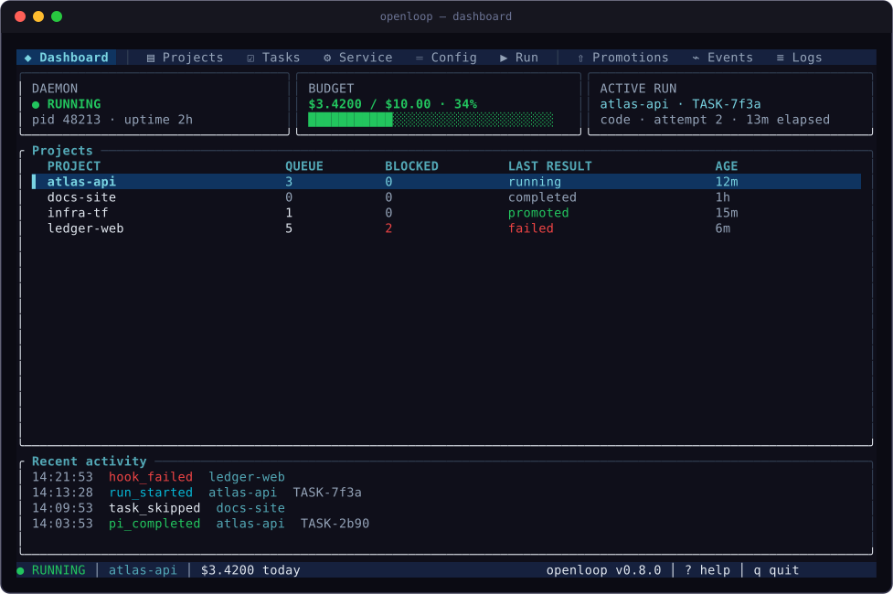
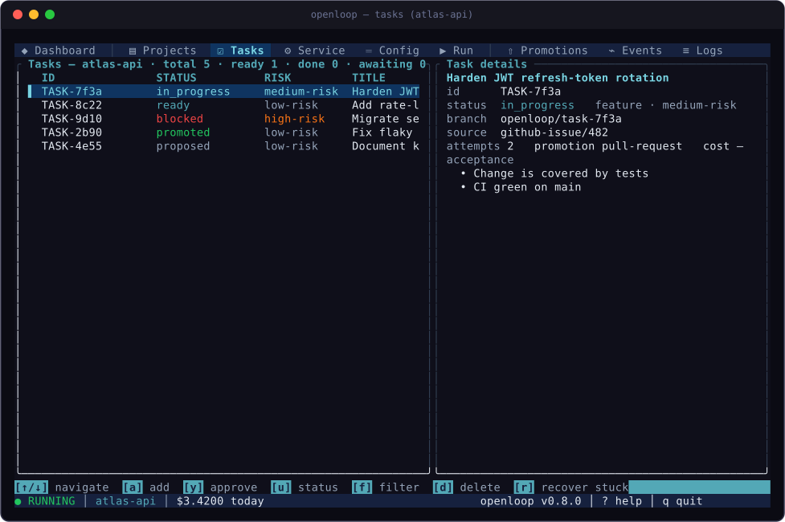
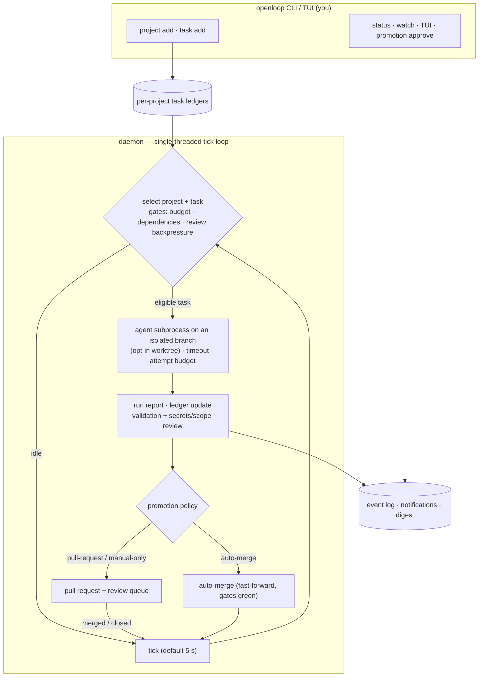

# OpenLoop

A global CLI and daemon for unattended AI-driven development across linked
project repositories. Pi is the default agent; the runtime also supports
Claude Code, Aider, Codex, OpenCode, ka, Oh My Pi, and arbitrary shell
commands through a provider abstraction.

OpenLoop is written in **Rust** — a single ~5 MB self-contained binary
(system libc linked, no runtime dependency). It starts in ~1 ms, idles at
~5 MB RSS, and ships one artifact everywhere.

## Install

**From source (requires [Rust](https://rustup.rs)):**

```sh
git clone https://github.com/jaltez/openloop
cd openloop
cargo install --path .
```

**Via cargo:**

```sh
cargo install --git https://github.com/jaltez/openloop
```

**Via npm (Linux x64/arm64 and macOS x64/arm64 prebuilt):**

```sh
npm install -g openloop
```

The npm package is a thin shim: `bin/openloop.js` resolves a prebuilt
binary when one ships for your platform, falls back to an existing
`target/release/openloop` checkout build, and otherwise exits with
install instructions. Set `OPENLOOP_BIN` to use an explicit binary.

## Quick start

```sh
# Link a repository and materialize the control plane
openloop project add myapp /path/to/repo --init

# Add work
openloop task add --project myapp --title "Fix the login redirect"

# Start the unattended daemon (or: openloop service run for foreground)
openloop service start

# Watch the fleet
openloop status
openloop watch
openloop            # interactive TUI (9 views, mouse support)

# Review pending promotions
openloop promotion list --project myapp
openloop approval list --project myapp
```

## The TUI



The dashboard: daemon health, the day's budget burn, the active run, the
whole project fleet, and the tail of the audit log.



Tasks per project: status, risk, dependencies, acceptance criteria, and the
promotion policy for the selected task. Both images are real renders of the
TUI driven by a fabricated control plane — see `docs/screenshot/` to
regenerate them.

## The loop



## What it does

- **Multi-project registry** (`~/.openloop/projects.json`): link repositories
  by alias; the daemon schedules work across all of them.
- **Control plane per project** (`.openloop/`): a task ledger with status,
  risk, scope and acceptance criteria; a scope policy (allow/deny globs,
  high-risk areas, promotion modes per risk class); validation commands;
  specs; runs; promotions; approvals.
- **Unattended scheduling**: low-risk-first with 24 h aging, `dependsOn`
  gating (including cross-repo `alias:task-id` refs — when an upstream
  dependency lands, waiting tasks get a `dependency_satisfied` event, a
  ledger note, and notifications), opt-in concurrent runs
  per tick (`runtime.maxConcurrentRuns`), max attempts, no-progress
  detection, budget ceilings, review backpressure, cron schedules, and
  crash recovery on daemon restart. `openloop status` (and the TUI status
  bar) names why each project is idle: paused, budget-blocked,
  review-backpressure, dependencies, no eligible tasks, or a missing
  provider.
- **Verified runs**: lint/test/typecheck gates plus project-defined custom
  gates (`openloop config project-add-validation`, first-class in auto-merge
  readiness), an independent verifier role judging acceptance criteria,
  deterministic secret/scope-drift review (AWS, GitHub, Slack, Google,
  OpenAI, JWT, private keys, generic assignments, plus a warn-severity
  high-entropy heuristic), and an optional LLM reviewer — all before
  anything is promoted.
- **Promotion flow**: auto-merge (low-risk, all validations green), pull
  requests via `gh` or a custom command, or manual-only; every decision
  leaves a JSON artifact trail plus a human-approval packet with diff stat,
  cost, and provenance. The daemon polls open PRs
  (`runtime.prRefreshIntervalSeconds`, default 300, 0 disables) so a merged
  PR promotes its task and a closed one releases the review queue without a
  manual `promotion refresh`.
- **Cost governance**: per-run measured cost when the agent reports usage,
  estimated fallback otherwise; daily budgets anchored to the daemon's start
  date; fleet digest with spend split and a confidence-ranked review queue.
- **Integrations**: lifecycle hooks (command/webhook), notification channels
  (webhook, Slack, Discord, Telegram, desktop) with a delivery ledger and
  bounded retry surfaced in `doctor`, GitHub/GitLab issue sync with status
  comments, a localhost web dashboard, and an MCP server over stdio (11
  tools, including read-only promotion detail and approval-packet access so
  a reviewer agent can pre-digest promotions for the human).
- **Retention**: each project prunes its control plane — the newest
  `retention.maxRunArtifactsPerTask` run summaries/transcripts (default 20)
  and `retention.maxPromotionResultsPerTask` promotion results (default 10)
  per task are kept, enforced on every daemon tick; the append-only event
  log and the pending-promotion queue are never touched. `doctor` reports
  per-project control-plane size.

## CLI surface

```
openloop project    add|list|activate|show|init|upgrade|remove  Linked projects
openloop task       add|list|show|update|remove|recover|approve
openloop promotion  list|show|history|apply|reject|refresh
openloop approval   list|show                             Approval packets
openloop config     show|set|set-model|set-provider|...   Global + project config
openloop service    start|stop|status|restart|pause|resume|run
openloop issue      set-source|sync|list|remove-source    GitHub/GitLab
openloop dashboard  start|enable|disable|status           Web dashboard
openloop run|run-once|enqueue|status|events|logs|watch|report|digest|doctor|setup|mcp
```

`events --follow` streams new events as the daemon appends them (like
`tail -f`).

Most commands take `--format json` for scripting; tables render on TTYs by
default. Run `openloop <command> --help` for the full surface.

## Architecture

```
src/
├── main.rs        entry point: TUI on bare TTY, CLI dispatch otherwise
├── lib.rs         library root (core | cli | tui) — powers integration tests
├── core/          domain logic, no terminal concerns
│   ├── types.rs     serde contracts for every on-disk artifact
│   ├── scheduler.rs task selection, prompts, promotion decisions,
│   │                no-progress detection, the full run iteration
│   ├── worker.rs    the daemon tick loop (budget, backpressure,
│   │                schedules, recovery, hooks/notifications)
│   ├── providers.rs subprocess engine: 7 built-in agents + custom
│   │                commands, detached process groups,
│   │                timeout kills with SIGKILL escalation + reaping,
│   │                usage/cost parsing, 4 MiB rolling capture
│   ├── promotion_queue.rs / promotion_artifacts.rs / approval_packets.rs
│   ├── review.rs    deterministic secrets + scope drift (+ optional LLM)
│   ├── policy/glob/cron/event-log/digest/report/issue-sync/hooks/...
│   ├── dashboard.rs localhost HTTP server (GET-only, snapshot-cached)
│   └── mcp_server.rs  stdio JSON-RPC 2.0 (11 tools)
├── cli/           clap definitions + dispatch (20 visible commands)
└── tui/           ratatui app: 9 views, tab-gated polling, shared
                    modals (input/confirm/picker), mouse support
                    (docs/TUI-REDESIGN.md)
```

Design notes:

- **Pure std concurrency** — the daemon is single-threaded with detached
  subprocesses, exactly like the product's semantics require; no async
  runtime, no tokio.
- **Identical state formats** to the earlier TypeScript implementation:
  JSON ledgers/artifacts with camelCase keys, `[:.]`-sanitized filenames,
  one `~/.openloop` home usable by either lineage.
- **Fail-closed subprocess handling**: every timeout/shutdown kill path
  reaps its children (SIGTERM → 5 s grace → SIGKILL → wait), and SIGTERM
  during an agent run interrupts it within ~250 ms.
- **Embedded templates**: `templates/project/` is compiled into the binary
  via `include_dir`, so `project init` works from a lone executable. The
  templates carry a version stamped into `.openloop/template-version`;
  `openloop project upgrade` brings linked repos up to it (backing up
  `.openloop/` first) while preserving `policy.yaml`, `project.json`
  values, and the task ledger; `doctor` reports drift.

## Development

```sh
cargo build            # debug build
cargo test             # 294 tests across 38 suites
cargo clippy           # zero warnings enforced in CI
cargo fmt              # formatting
cargo run -- status    # try it against a sandbox: OPENLOOP_HOME=/tmp/x cargo run -- status
```

The integration tests create their own sandboxes; the daemon-shutdown test
spawns the compiled binary, a sleeping agent, and asserts the full
SIGTERM → kill → pid-cleanup → exit sequence.

`npm run verify` gates a release: clippy, tests, release build, CLI smoke,
and the npm tarball manifest.

## Metrics vs the TypeScript original

| Metric | TS (node) | Rust | Ratio |
|---|---|---|---|
| CLI startup | 77 ms | **1.2 ms** | ~64x |
| Idle daemon RSS | ~71–75 MB | **5.0 MB** | ~14x |
| CLI RSS | 79 MB | **3.4 MB** | ~23x |
| Deployable artifact | ~377 MB (dist+deps+node) | **5.0 MB** | ~75x |
| Runtime dependency | Node ≥ 22 / Bun | none | — |

## License

MIT
